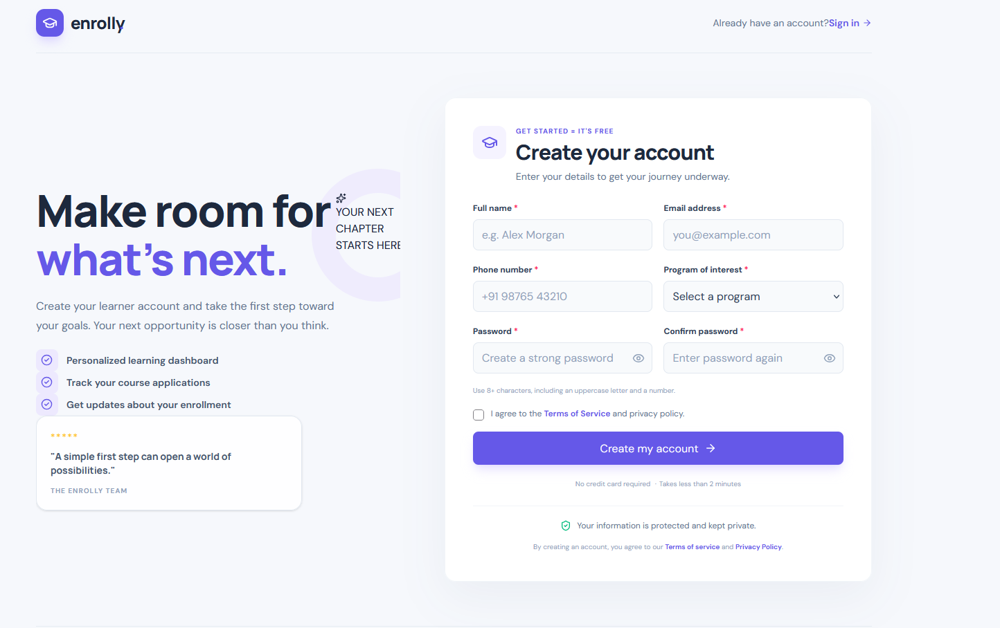

# Enrollly — Student Registration Portal

A modern, responsive student registration portal built with **React, JavaScript, Tailwind CSS v4, Formik, and Yup**. The application features reusable form components, client-side validation, password visibility controls, API integration, and success/error notifications.

## 📸 Application Screenshot



## ✨ Features

- **Responsive UI:** Adapts to desktop, tablet, and mobile screens.
- **Reusable components:** Shared form fields, password fields, buttons, and notification components.
- **Formik form management:** Handles form state, submission, and validation integration.
- **Yup validation:** Validates required fields, email, phone number, password strength, password confirmation, course selection, and terms acceptance.
- **Password visibility:** Toggle between visible and hidden password input.
- **API integration:** Sends registration details to a configurable API endpoint.
- **Feedback notifications:** Displays success and error messages.
- **Loading state:** Shows a loading indicator while submitting.
- **Tailwind CSS v4:** Provides utility-first styling without a traditional Tailwind configuration file for this setup.
- **Environment variables:** Supports configuring the API base URL through `.env`.

## 🛠️ Tech Stack

| Technology | Purpose |
|---|---|
| React | UI components and application structure |
| JavaScript | Application logic |
| Vite | Development server and build tooling |
| Tailwind CSS v4 | Responsive styling |
| Formik | Form state and submission management |
| Yup | Form validation schema |
| Lucide React | Icons |
| Fetch API | HTTP requests |

## 📁 Project Structure

```text
registration-portal/
├── public/
│   └── screenshots/
│       └── registration-portal.png
├── src/
│   ├── components/
│   │   ├── form/
│   │   │   ├── FormField.jsx
│   │   │   └── PasswordField.jsx
│   │   ├── registration/
│   │   │   └── RegistrationForm.jsx
│   │   └── ui/
│   │       ├── Button.jsx
│   │       └── Notice.jsx
│   ├── services/
│   │   └── registrationApi.js
│   ├── validation/
│   │   └── registrationSchema.js
│   ├── App.jsx
│   ├── main.jsx
│   └── index.css
├── .env
├── .gitignore
├── index.html
├── package.json
├── vite.config.js
└── README.md
```

### Folder responsibilities

- `components/form/` — Reusable input and password field components.
- `components/registration/` — Registration form and submission logic.
- `components/ui/` — Shared buttons and notification components.
- `services/` — API communication and registration requests.
- `validation/` — Centralized Yup validation schema.
- `App.jsx` — Main page layout and registration success state.
- `index.css` — Tailwind CSS import and global styles.
- `public/screenshots/` — Screenshots used in project documentation.

## 🚀 Getting Started

### Prerequisites

Install the following before running the project:

- [Node.js](https://nodejs.org/) — preferably a current LTS version.
- npm — included with Node.js.
- Git — optional, for version control.

### 1. Clone the repository

```bash
git clone https://github.com/06naresh/registration-portal.git
cd registration-portal
```

### 2. Install dependencies

```bash
npm install
```

If you are creating the project from scratch, install the required packages:

```bash
npm install formik yup lucide-react
npm install tailwindcss @tailwindcss/vite
```

### 3. Configure environment variables

Create a `.env` file in the project root:

```env
VITE_API_BASE_URL=https://jsonplaceholder.typicode.com
```

The application uses this variable to determine the API base URL.

**Important:** Variables prefixed with `VITE_` are exposed to client-side code. Do not store passwords, API secrets, or other private credentials in them.

### 4. Start the development server

```bash
npm run dev
```

Open the local URL printed in your terminal, usually:

```text
http://localhost:5173
```

### 5. Build for production

```bash
npm run build
```

Vite generates the production build in the `dist/` directory.

To preview the production build locally:

```bash
npm run preview
```

## 📝 Form Validation

The registration form uses Formik and Yup to validate user input.

| Field | Validation |
|---|---|
| Full name | Required; 2–60 characters |
| Email | Required; valid email format |
| Phone | Required; valid phone characters and length |
| Course | Required |
| Password | Required; at least 8 characters, one uppercase letter, and one digit |
| Confirm password | Must match the password |
| Terms and conditions | Must be accepted |

Validation messages appear alongside the relevant fields to help users correct their input.

## 🌐 API Integration

API requests are handled in:

```text
src/services/registrationApi.js
```

The registration service sends the name, email, phone number, and selected course to:

```text
POST ${VITE_API_BASE_URL}/users
```

The default endpoint uses JSONPlaceholder for demonstration purposes.

**Demo API limitations:**

- JSONPlaceholder simulates API responses; it does not create real student accounts.
- Registration data is not permanently stored as a real user account.
- The password is intentionally excluded from the demo request.
- For a production application, connect a secure backend that validates input, hashes passwords, and stores accounts safely.

## 🧩 Concepts Demonstrated

This project provides practice with:

- Functional React components
- Parent-to-child props
- Component reusability
- Controlled form inputs
- Formik form handling
- Yup schema validation
- React state with `useState`
- React hooks such as `useId`
- Asynchronous JavaScript with `async` and `await`
- API integration with `fetch`
- Environment variables with Vite
- Responsive design with Tailwind CSS
- Conditional rendering and error handling

## 🔮 Future Improvements

- Connect to a real registration backend and database.
- Add email verification.
- Add login and authentication.
- Add a course catalogue populated from an API.
- Add automated component and form validation tests.
- Add deployment instructions and a live demo link.

## 📄 License

This project is intended for learning and demonstration. Add a license file if you plan to distribute it publicly.

---

**Built with React, Tailwind CSS, Formik, and Yup.**